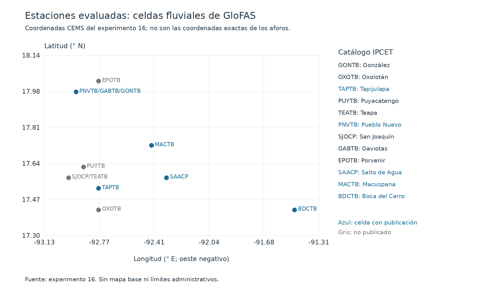
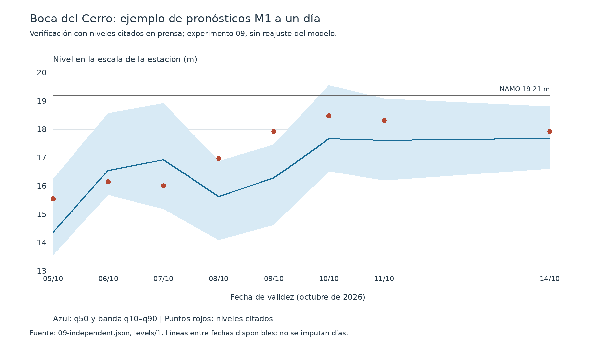
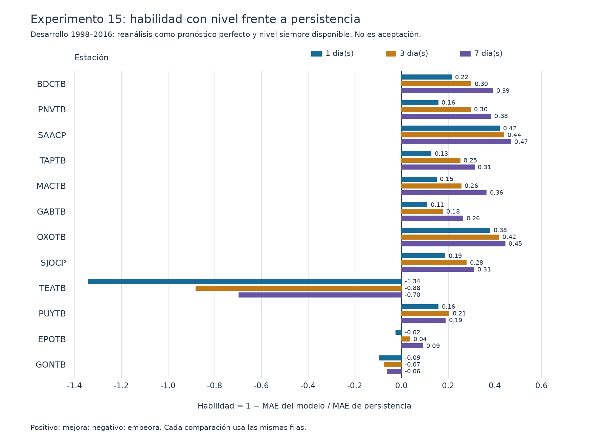
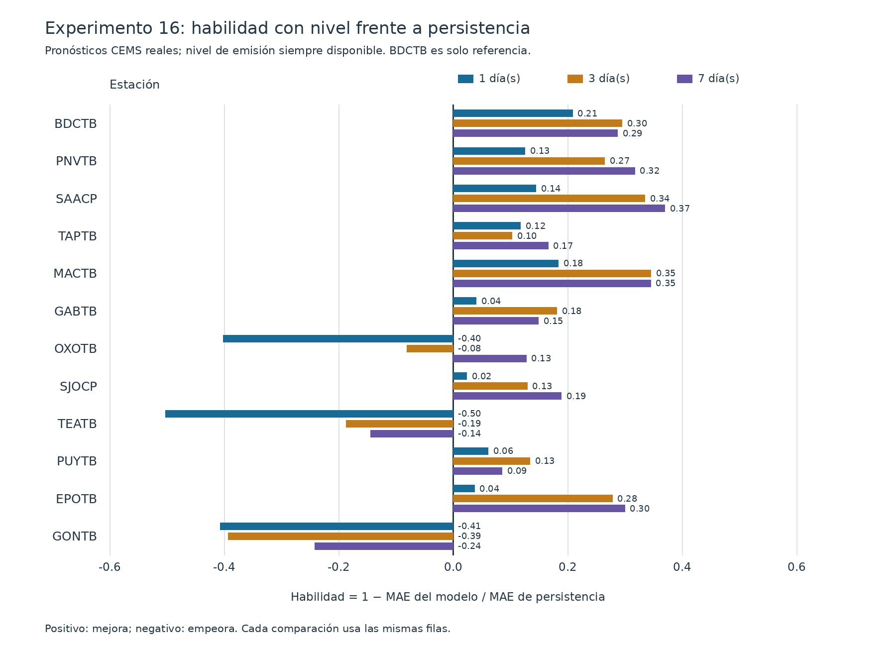

# Pronóstico del nivel de ríos de Tabasco con datos públicos: modelado probabilístico y validación temporal

**Autores:** Guillermo Antonio Jiménez de la Cruz y Fernando Pech-May  
**Institución:** Tecnológico Nacional de México, Instituto Tecnológico Superior de los Ríos (ITSR), Balancán, Tabasco, México  
**Fecha:** octubre de 2026

## 1. Resumen

Este trabajo desarrolla un pronóstico del nivel de ríos de Tabasco a uno, tres y siete días, con datos públicos y una evaluación temporal documentada. El estudio comienza en Boca del Cerro, sobre el Usumacinta, y evalúa después las estaciones para las que se encontró una celda fluvial de GloFAS. Se combinan el caudal pronosticado por GloFAS, la estacionalidad y, cuando está disponible, el nivel de las 06:00 publicado por IPCET. El modelo utiliza regresión por cuantiles con árboles de gradiente y calibración conformal para producir una mediana y una banda q10–q90 de cobertura nominal del 80 %.

En Boca del Cerro, la reevaluación posterior a la auditoría obtiene errores absolutos medios de 0.367, 0.470 y 0.636 m frente al nivel SIH de agosto de 2023 a septiembre de 2025; el modelo sin nivel reciente obtiene 0.677, 0.669 y 0.718 m en las mismas filas. Frente a IPCET, entre septiembre de 2025 y octubre de 2026, los errores son 0.326, 0.449 y 0.593 m, con coberturas inferiores a la nominal. Estas cifras son retrospectivas y no sustituyen una validación prospectiva prolongada (experimento 13).

La extensión por estación se entrenó con reanálisis, no con repronósticos completos, porque la descarga restante no era viable dentro del plazo. En la evaluación con pronósticos operativos reales, Teapa y González no superaron la persistencia en ningún horizonte; Oxolotán solo lo hizo a siete días. Como decisión de producto posterior a la evaluación, se publican Macuspana, Salto de Agua, Pueblo Nuevo y Tapijulapa, además de Boca del Cerro, conforme al criterio de la sección 4.4 (experimento 16).

El informe conserva los resultados negativos: la lluvia satelital no se admitió, la recalibración de avisos no resolvió la sobreestimación operativa y ampliar el entrenamiento produjo una mejora pequeña. La operación usa GitHub Actions, un mensajero de imágenes IPCET y una aplicación con caché local. El producto es un pronóstico en estaciones, no un mapa de inundación ni un aviso oficial.

---

## 2. Introducción

Un pronóstico de nivel debe aportar información adicional a la que ya ofrece la lectura actual del río. En ríos que cambian lentamente, conservar el último nivel observado puede ser una referencia difícil de superar. Por ello, una reducción del error frente a la climatología no basta para justificar la publicación: también hace falta comparar con la **persistencia**, es decir, transportar el nivel del día de emisión al día pronosticado.

El antecedente del proyecto empleaba datos públicos, pero no informaba esa comparación. En su evaluación de 2017–2019, el error de la mediana era 0.71, 0.71 y 0.68 m a uno, tres y siete días; la persistencia, en el mismo periodo, obtenía 0.20, 0.45 y 0.70 m. La aparente capacidad predictiva dependía, por tanto, del horizonte. Ese diagnóstico motivó reconstruir el proceso y documentar tanto las decisiones favorables como las fallidas.

**Pregunta de investigación.** ¿Es posible, únicamente con datos públicos disponibles al emitir el pronóstico, anticipar el nivel de los ríos de Tabasco mejor que la persistencia, cuantificar su incertidumbre y mantener una publicación operativa verificable por estación y horizonte?

El enfoque consiste en aprender la relación entre caudal modelado y nivel observado, reservar años completos para evaluación y admitir nuevas entradas solo cuando aporten valor fuera del ajuste. Se parte de Boca del Cerro (BDCTB), donde se dispone de una historia extensa; después se estudia la transferibilidad a las estaciones de la tabla oficial IPCET. La disponibilidad real de un nivel reciente resulta tan importante como la arquitectura del modelo.

**Definición del producto.** Se pronostica el nivel en la escala de cada estación. No se estima la extensión espacial de una inundación, una profundidad sobre el terreno ni una probabilidad de daño. La distancia al nivel de aguas máximo ordinario (NAMO) es una referencia de escala, no una regla propia de semáforo. La aplicación conserva por separado los estados oficiales de IPCET (sección 6.3).

Las secciones siguientes presentan los antecedentes, los datos y el protocolo; reconstruyen la secuencia experimental sin reemplazar resultados originales por reevaluaciones; describen la operación y sus límites; y proporcionan una ruta de reproducción.

---

## 3. Trabajos relacionados

GloFAS proporciona una base hidrológica global que permite elaborar pronósticos donde no existe una cadena local accesible. Alfieri et al. [1] describen el sistema de predicción por conjuntos; Harrigan et al. [2] documentan el reanálisis GloFAS-ERA5. Ambos son antecedentes de la fuente de caudal, no una validación de la conversión local de caudal a nivel. La versión usada aquí se identifica por los archivos y por el catálogo operativo CEMS [5]; no se atribuye a esos trabajos una evaluación específica de GloFAS v4 en Tabasco.

La regresión conformal por cuantiles de Romano, Patterson y Candès [3] ofrece el fundamento para ajustar intervalos a partir de errores fuera del ajuste. En series hidrológicas con dependencia temporal y cambios de distribución, la cobertura debe medirse en los periodos retenidos: no se interpreta como una garantía universal. Para los avisos, Bartholmes et al. [4] aportan un antecedente de verificación de sistemas hidrológicos por conjuntos y de persistencia entre emisiones.

| Trabajo o sistema | Datos y método | Producto | Relación con este estudio |
|---|---|---|---|
| Alfieri et al. [1] | Predicción meteorológica por conjuntos y modelado hidrológico global | Pronóstico de caudal GloFAS | Fuente de la señal hidrológica; no entrega directamente el nivel de la escala local |
| Harrigan et al. [2] | Reanálisis GloFAS-ERA5 | Historia de caudal modelado | Base para estudiar relaciones y límites; reanálisis no equivale a pronóstico emitido |
| Romano et al. [3] | Regresión por cuantiles y calibración conformal | Intervalos predictivos | Fundamento de la banda de incertidumbre, con evaluación temporal explícita |
| Bartholmes et al. [4] | Verificación de predicción hidrológica por conjuntos | Evaluación de avisos | Antecedente de la regla de emisiones consecutivas; aquí no crea un semáforo oficial |
| Este trabajo | SIH, GloFAS y nivel público IPCET; gradiente por cuantiles | Nivel y banda por estación | Contrasta con persistencia, informa fallos y separa aceptación de publicación |

: Comparación de antecedentes. No se comparan sus métricas absolutas: difieren el objetivo, la escala y los periodos.

La contribución no es un nuevo modelo hidrológico global. Es una cadena reproducible para traducir sus salidas a una escala de aforo, incorporar una observación pública reciente y comprobar cuándo esa combinación añade valor frente a una referencia sencilla.

---

## 4. Materiales y métodos

### 4.1 Área de estudio y estaciones

El dominio es la red de estaciones publicada por IPCET en Tabasco y su entorno hidrológico. La revisión del inventario corrigió una identificación inicial excesiva: la tabla contiene **14 estaciones en 13 ríos**, además de las presas del Grijalva; no las 16 estaciones mencionadas en etapas anteriores. Las estaciones de Salto de Agua y San Joaquín tienen archivos SIH de Chiapas que prolongan la evaluación respecto de las estaciones de Tabasco (experimento 16).

| Código SIH | Estación | Río de la tabla IPCET | Situación en el estudio |
|---|---|---|---|
| BDCTB | Boca del Cerro | Usumacinta | Referencia inicial y producción con repronósticos |
| MACTB | Macuspana | Puxcatán | Publicada; criterio de la sección 4.4 |
| SAACP | Salto de Agua | Tulijá | Publicada; criterio de la sección 4.4 |
| PNVTB | Pueblo Nuevo | De la Sierra | Publicada; criterio de la sección 4.4 |
| TAPTB | Tapijulapa | Tacotalpa | Publicada; criterio de la sección 4.4 |
| GABTB | Gaviotas | Grijalva | Evaluada; lectura IPCET no utilizable para despliegue |
| EPOTB | Porvenir | Grijalva | Evaluada; no publicada |
| GONTB | González | Carrizal | Evaluada; no aceptada |
| OXOTB | Oxolotán | Oxolotán | Evaluada; aceptada solo a siete días |
| SJOCP | San Joaquín | Pichucalco | Evaluada; no publicada |
| TEATB | Teapa | Teapa | Evaluada; no aceptada |
| PUYTB | Puyacatengo | Puyacatengo | Evaluada; no publicada |
| SAMTB | Samaria | Samaria | Sin celda GloFAS admisible |
| SPTTB | San Pedro | San Pedro | Sin celda GloFAS admisible |

: Inventario y alcance: experimento 16 y catálogo de la tabla IPCET del repositorio; publicación según la sección 4.4.



**Figura 1.** Localización esquemática de las estaciones mediante sus celdas CEMS del experimento 16. No representa límites administrativos ni las coordenadas exactas del aforo. Las etiquetas compartidas indican una misma celda, no una misma estación. Samaria y San Pedro no aparecen por carecer de celda admisible. Fuente: `16-station-models.json`, apartado `extraction`.

En Boca del Cerro, la cuenca trazada con HydroBASINS comprende 380 subcuencas y 51 457 km². Ese valor reemplaza la aproximación inicial de 49 735 km²: el primero corresponde al trazado finalmente versionado en `data/basins/BDCTB.geojson`. La presencia de regulación por Peñitas limita la interpretación de las estaciones del sistema Grijalva. En los ríos pequeños de la sierra, la respuesta rápida puede estar mal resuelta por GloFAS y por una observación diaria (experimento 16).

### 4.2 Datos y funciones de cada fuente

| Fuente | Periodo o disponibilidad documentados | Función y precaución |
|---|---|---|
| CONAGUA SIH, nivel y gasto | BDCTB: 1997-01-01 a 2025-09-03 en el análisis de cobertura | Nivel objetivo de entrenamiento y validación; nunca se imputa. El gasto ayuda a seleccionar celda y diagnosticar sesgos |
| GloFAS v4, reanálisis `consolidated_v4` | BDCTB: hasta 2025-05-31 | Historia para relaciones y entrenamiento; no se supone disponible en tiempo real |
| GloFAS v4, repronósticos CEMS | Importación BDCTB: emisiones 2004-01-01 a 2023-11-25; 11 miembros | Entrenamiento y prueba iniciales con pronósticos históricos; cobertura desigual por horizonte |
| GloFAS v4, archivo operativo CEMS | Emisiones 2023-08-01 a 2026-10-13 | Evaluación con pronósticos realmente emitidos; se resumen los mismos 11 miembros que en entrenamiento |
| Open-Meteo, `forecast_v4` [6] | Archivo diario de día cero y servicio de conjunto | Caudal pasado disponible en operación y fuente viva adoptada tras comparar con CEMS |
| IPCET, mapa de semáforo [7] | Muestra 2026 del experimento 05 | Verificación ordinal independiente; no sirve para estimar umbrales con tan pocos estados altos |
| IPCET, tabla de niveles [7] | Primera tabla localizada: 2021-08-03 | Lectura de las 06:00, ayer/hoy, diferencia, NAMO y estado oficial; entrada viva y objetivo posterior al cierre SIH |
| IMERG Early V07 [8] y pluviómetro CONAGUA | Lluvia de cuenca completa 1998-01-01 a 2026-10-13 | Variable candidata, comprobada y finalmente excluida del pronóstico |

: Fuentes y papeles: experimentos 00, 04, 05, 10, 11, 14 y 16. El catálogo CEMS [5] identifica el producto operativo. La disponibilidad solicitada no implica que todos los días entren en cada evaluación.

**Cobertura del objetivo.** BDCTB tiene 9 922 días con nivel de 10 473 posibles, un 94.7 %. El mayor hueco dura 99 días, del 24 de septiembre al 31 de diciembre de 2011, y comprende parte crítica de aquella crecida. Los valores faltantes se excluyen, no se completan. Una nueva descarga confirmó que el SIH de BDCTB no aportaba observaciones posteriores al 3 de septiembre de 2025; la evaluación posterior usa IPCET como objetivo (experimento 12).

**Celda fluvial.** No se elige simplemente el píxel más próximo. El procedimiento exige una relación de medias entre 0.5 y 2, compara correlaciones con adelantos de cero a cinco días y resuelve diferencias de correlación dentro de 0.005 por cercanía. En BDCTB se seleccionó la celda Open-Meteo 17.425, −91.525, con correlación 0.832 y adelanto de dos días; la celda más cercana no correspondía al cauce. Para otras estaciones se preserva el mismo procedimiento de selección. Las etiquetas de longitud de Open-Meteo y CEMS tienen un desplazamiento documentado: la extracción del experimento 16 aplica la correspondencia física, no una resta indistinta de coordenadas (experimentos 14 y 16).

**Lluvia.** El experimento 00 compara 316 meses con al menos 25 días observados: correlación mensual 0.689 y medias de 205 mm en IMERG frente a 191 mm en el pluviómetro. La relación anual varía entre 0.72 y 1.55. Un único pluviómetro en la salida no valida por sí solo la lluvia de toda la cuenca, en buena parte fuera de México (experimento 00). Estas discrepancias se conservan antes de juzgar el valor predictivo.

**Disponibilidad de IPCET.** El censo encontró tablas en el 83, 77, 73, 73, 73 y 61 % de los días de los años disponibles de 2021 a 2026, respectivamente; en los últimos doce meses, 64 %. Los fines de semana y los periodos festivos explican buena parte de los huecos. La columna «ayer» eleva la proporción de días cuyo nivel termina siendo publicado, pero no implica que estuviera disponible al emitir el pronóstico (censo `data/raw/ipcet/levels_census.csv`). De una muestra de 40 tablas, 28 se cargaron el mismo día, entre las 07:18 y las 13:44; las demás llegaron después. `Last-Modified` es indicativo porque puede cambiar por una recarga del archivo.

**Lectura y semáforo.** Se verifican la fecha impresa, la aritmética hoy menos ayer, el NAMO y la continuidad. Las imágenes pueden reutilizarse en páginas de otros años. Un hoy con diferencia impresa cero puede ser una copia del valor anterior y se excluye como lectura actual. Los conflictos y las confirmaciones se resuelven solo con tablas ya visibles al emitir (experimentos 11 y 13).

El semáforo de la tabla no es el del mapa hidrometeorológico. Su vocabulario es NORMAL, A LA BAJA, BAJO, PREVENCION, ALERTA y EMERGENCIA. El levantamiento documentado en `docs/semaforo-states.md` localizó 612 tablas entre 638 imágenes y distinguió 8 568 celdas: 6 454 NORMAL, 290 A LA BAJA, 85 BAJO, 40 PREVENCION, 12 ALERTA y 2 EMERGENCIA por texto confirmado; 1 685 quedaron sin texto reconocido. Los fondos marrón y morado no se agrupan con rojo. Un estado desconocido no se transforma en NORMAL. Estos estados son observados, no calculados desde q50 o NAMO (`docs/semaforo-states.md`).

### 4.3 Modelo probabilístico: referencia sin nivel y modelo con nivel vivo

Se ajusta un modelo por horizonte de uno, tres y siete días. Cada modelo aprende los cuantiles q10, q50 y q90 mediante `HistGradientBoostingRegressor` de scikit-learn, con pérdida de cuantiles. **No es LightGBM** (experimento 02). Las predicciones se ordenan para impedir cruces. La mediana es el pronóstico puntual; los extremos delimitan una banda nominal del 80 %.

El modelo sin nivel reciente utiliza resúmenes del conjunto de caudal, caudal pasado, cambios respecto del estado inicial y estacionalidad. La calibración conformal calcula un margen a partir de predicciones fuera del ajuste en bloques internos de tres años. Ensancha la banda sin alterar la mediana, siguiendo la idea de regresión conformal por cuantiles [3]. No se recalibra mirando la prueba (experimentos 02, 10 y 15).

En este informe se distinguen:

- **Modelo original congelado:** ajustado con objetivos de 1998–2016 y repronósticos disponibles. Es el evaluado inicialmente en los experimentos 04–06.
- **M1, modelo sin nivel vivo:** misma receta reajustada con objetivos hasta 2022 en la reevaluación posdiagnóstico. También designa el comparador y respaldo sin nivel en las etapas posteriores, con el periodo de ajuste indicado en cada experimento (experimento 08).
- **Modelo con nivel vivo:** añade el último nivel público utilizable, su edad y el caudal del día de ese nivel. Su entrenamiento simula la disponibilidad de IPCET sobre el SIH; no exige una observación actual en todos los días. Si no hay un nivel dentro de la ventana admitida, usa M1 (experimentos 10 y 12).

Tras la auditoría, todo caudal pasado de entrenamiento se desplaza un día para corresponder al archivo de día cero: `past[d] = reanalysis[d-1]`. En operación, también el caudal del día del último nivel procede del archivo de día cero, no del reanálisis. El corte de disponibilidad se fija a las 11:00, hora de Ciudad de México, y la serie se reconstruye causalmente con las imágenes visibles hasta ese corte (experimento 13). Se admiten edades de cero a siete días, inclusive; a ocho días se usa el respaldo (`docs/forecast-schema.md`).

### 4.4 Protocolo temporal, referencias y regla de aceptación

La separación inicial reserva **1998–2016 para desarrollo y 2017–2025 para prueba**. Se validan bloques de cuatro años completos con una separación de catorce días; no se reparten días al azar entre ajuste y evaluación. Las filas efectivamente disponibles dependen del horizonte: faltan repronósticos largos en buena parte de los últimos años. Nunca se imputa el objetivo para conservar una fecha (experimentos 01 y 04).

Las referencias son climatología por día del año, una conversión caudal–nivel o *rating* y persistencia. En los experimentos por estación se comparan todos los métodos sobre exactamente las mismas filas. La habilidad se define como:

**Habilidad = 1 − MAE del modelo / MAE de persistencia.**

Un valor positivo mejora la persistencia; cero empata; negativo empeora. Se informan además RMSE, pérdida de cuantiles, anchura y cobertura inclusiva q10–q90. Para aguas altas en BDCTB se fijó antes de la prueba el percentil de desarrollo: nivel igual o mayor que 17.83 m. POD es aciertos entre eventos; FAR es falsas alarmas entre avisos, no entre todos los días (experimentos 01 y 06).

Los diseños de verificación de avisos, reevaluación posdiagnóstico, evidencia independiente, valor del nivel vivo, prueba final, correcciones posauditoría y extensión por estación se registraron antes de sus respectivas evaluaciones (experimentos 06, 08–10, 12, 13, 15 y 16). Cuando un periodo ya fue consultado, no vuelve a llamarse «no visto»: las reevaluaciones se presentan junto con el resultado original.

**Regla de aceptación.** Un horizonte de una estación es elegible si, en el periodo de prueba retenido y sobre las mismas filas, el MAE de su mediana es estrictamente menor que el de persistencia del nivel del día de emisión. No se ajusta ningún umbral con la prueba y se informan todas las estaciones, aceptadas o no. La condición original exigía también habilidad positiva del respaldo donde se publicara; en el experimento 16, la aceptación se decidió por el modelo con nivel vivo, sin que M1 decidiera. La publicación posterior mantuvo M1 como respaldo identificado para dar continuidad, no como demostración de que cumpliera aquella condición original (`docs/results/16-station-models.md`; `docs/operations.md`).

**Regla de publicación.** Después de la evaluación se decidió publicar una estación si era elegible en los tres horizontes por la regla anterior y su habilidad con nivel vivo a un día era al menos 0.10. Es una decisión de producto posterior a conocer el experimento 16, no una condición de aceptación prerregistrada. Se priorizó el horizonte que se consulta diariamente y se evitó añadir estaciones prácticamente empatadas con persistencia o sin lectura pública utilizable. Boca del Cerro, ya operativa, conservó su modelo de producción; los artefactos añadidos conservaron exactamente las filas de entrenamiento y la receta evaluadas, sin reajuste con datos desde 2023 (`docs/operations.md`).

El **experimento 15** solo estima un techo orientativo en desarrollo con reanálisis como pronóstico perfecto. No acepta ni excluye estaciones para publicación. El **experimento 16** ajusta con objetivos de 1999–2022, usa reanálisis como entrada de pronóstico durante entrenamiento y evalúa una vez con CEMS operativo desde agosto de 2023. El inicio común en 1999 evita el cambio de escala de Teapa. La lectura de emisión SIH está siempre disponible en esa evaluación: simula una tabla diaria perfecta, no los huecos reales de IPCET (experimentos 15 y 16).

---

## 5. Resultados

### 5.1 Boca del Cerro: referencias y modelo inicial

En desarrollo, la climatología general obtiene MAE de 1.145 m y la conversión sobre reanálisis perfecto 0.741 m; ese segundo número es un techo, no un pronóstico. Al emplear repronósticos reales, la conversión obtiene 0.805, 0.787 y 0.803 m. El modelo por cuantiles baja esos errores a 0.684, 0.658 y 0.712 m (experimentos 01–02).

| Método en desarrollo | MAE h1 / h3 / h7 (m) | Cobertura h1 / h3 / h7 |
|---|---|---|
| Conversión sobre repronóstico | 0.805 / 0.787 / 0.803 | 0.732 / 0.733 / 0.729 |
| Gradiente por cuantiles sin margen | 0.684 / 0.658 / 0.712 | 0.510 / 0.531 / 0.533 |
| Gradiente más calibración conformal | 0.684 / 0.658 / 0.712 | 0.803 / 0.808 / 0.822 |

: Experimento 02; filas comunes por horizonte. La calibración mejora la cobertura, no el error de la mediana.

Los intervalos sin calibrar cubrían apenas alrededor de la mitad de las observaciones. El margen conformal lleva la cobertura cerca de la nominal, con anchuras de 2.097, 2.103 y 2.257 m. Aun así, a siete días no mejora el error en aguas altas respecto de la conversión: ambos obtienen 1.605 m. La ganancia media no equivale a mejorar todos los regímenes (experimento 02).

### 5.2 La lluvia no se admite

| Entradas | MAE h1 / h3 / h7 (m) | POD de aguas altas h1 / h3 / h7 |
|---|---|---|
| GloFAS | 0.684 / 0.658 / 0.712 | 0.721 / 0.697 / 0.465 |
| GloFAS más lluvia de cuenca | 0.702 / 0.670 / 0.705 | 0.733 / 0.606 / 0.415 |

: Experimento 03; evaluación de desarrollo sobre los mismos días.

La lluvia empeora el MAE a uno y tres días y solo lo reduce ligeramente a siete, donde además disminuye la detección y crece el error en aguas altas de 1.605 a 1.673 m. Se conserva el modelo sin lluvia. No se buscaron más variantes sobre desarrollo para rescatar una mejora después de ver este resultado (experimento 03). La exclusión es específica de esta variable, agregación y receta; no demuestra que la precipitación carezca de información hidrológica.

### 5.3 Prueba inicial retenida

| Horizonte | Periodo de objetivos | n | MAE modelo / conversión / climatología (m) | Cobertura modelo |
|---|---|---:|---|---:|
| h1 | 2017-01-02 a 2023-11-26 | 796 | 0.594 / 0.793 / 1.144 | 0.766 |
| h3 | 2017-01-04 a 2019-12-31 | 337 | 0.578 / 0.778 / 1.074 | 0.730 |
| h7 | 2017-01-01 a 2020-01-04 | 341 | 0.600 / 0.771 / 1.118 | 0.757 |

: Experimento 04. Los horizontes no cubren el mismo periodo.

El modelo supera la conversión y la climatología, pero las bandas quedan por debajo del 80 %. A un día hay 64 observaciones de aguas altas: MAE 1.000 m, POD 0.781 y FAR 0.180. A tres y siete días solo hay cinco y cuatro observaciones altas, respectivamente; no sostienen una conclusión firme sobre crecidas. El experimento original no demuestra superioridad frente a persistencia: esa comparación se incorpora explícitamente en las etapas con nivel observado.

### 5.4 Pronósticos operativos, falsas alarmas y diagnóstico

El primer resultado con CEMS operativo, sin cambiar el modelo congelado, es peor que el de repronósticos: MAE 0.710, 0.697 y 0.732 m, con 693, 689 y 687 filas. La cobertura es 0.799, 0.798 y 0.805, pero las falsas alarmas de aguas altas alcanzan 0.566, 0.500 y 0.554. Usar los 51 miembros en vez del subconjunto comparable produce MAE de 0.710, 0.696 y 0.710 m; no explica por sí solo el problema (experimento 05).

Se evaluó una probabilidad de superar 17.83 m, reconstruida de los cuantiles y recalibrada isotónicamente solo en desarrollo. R0 usa la mediana; R1 emplea un umbral elegido para igualar en desarrollo la frecuencia de avisos y eventos; R2 exige emisiones consecutivas sobre ese umbral, con antecedente en sistemas de conjuntos [4]. Los umbrales fijados fueron 0.750, 0.667 y 0.318 (experimento 06).

| Regla en operación original | POD h1 / h3 / h7 | FAR h1 / h3 / h7 |
|---|---|---|
| R0, mediana | 0.676 / 0.688 / 0.781 | 0.566 / 0.500 / 0.554 |
| R1, umbral probabilístico | 0.706 / 0.750 / 0.812 | 0.564 / 0.607 / 0.662 |
| R2, emisiones consecutivas | 0.676 / 0.688 / 0.750 | 0.477 / 0.569 / 0.593 |

: Experimento 06. R2 solo reduce claramente FAR sin pérdida de POD a un día; no resuelve el problema en todos los horizontes.

La habilidad de Brier operativa es 0.161, 0.195 y −0.006, pese a ROC AUC de 0.957, 0.967 y 0.946. Discriminar días altos no garantiza probabilidades fiables. La tasa de eventos del desarrollo era cercana al 12 %, frente al 4.6–4.9 % operativo: imponer la frecuencia antigua favoreció el exceso de avisos. El valor económico relativo también dependió de la relación costo/pérdida y fue menos amplio en operación; no constituye un beneficio monetario demostrado (experimento 06).

El diagnóstico del experimento 07 encontró que el sesgo de nivel alto a un día pasó de −0.138 m en 2023 a +0.774 m en 2024 y −1.544 m en 2025, este último con solo cuatro días altos en el subconjunto diagnóstico. En 2024, las razones de medianas y percentiles altos del caudal GloFAS frente al observado fueron 1.330 y 1.249. La anomalía anual de caudal fue la explicación principal, no un cambio uniforme que pudiera corregirse con una constante histórica (experimento 07).

La relación observada caudal–nivel sí cambió, principalmente en 2017–2022, pero no explicó toda la anomalía. El gasto SIH podría derivarse a su vez del nivel, lo que reduce la independencia de ese diagnóstico. El experimento 07 juzgó pequeñas las diferencias de fuente pasada y conjunto; una auditoría posterior encontró además un desfase de etiquetado de un día que esa comparación inicial no había identificado. Se conserva el diagnóstico original con esa salvedad, no como prueba de que no hubiera errores de alineación (experimentos 07 y 13).

### 5.5 Reevaluación posdiagnóstico: mejora pequeña

M1 se reajustó hasta 2022 sin cambiar variables ni hiperparámetros. Su evaluación sobre el periodo ya consultado se etiquetó como posdiagnóstico, no como una nueva prueba ciega (experimento 08).

| Modelo | MAE h1 / h3 / h7 (m) | Sesgo con nivel observado de al menos 15 m, h1 / h3 / h7 (m) |
|---|---|---|
| Original congelado | 0.710 / 0.697 / 0.732 | +0.267 / +0.196 / +0.106 |
| M1, ajuste hasta 2022 | 0.706 / 0.685 / 0.717 | +0.333 / +0.130 / +0.042 |

: Experimento 08; mismas filas por horizonte.

La ganancia de MAE es de 0.004–0.015 m, menor que la mejora esperada. El sesgo alto a un día incluso aumenta. En 2024 persiste una sobreestimación de +0.782 m a un día y la habilidad de Brier anual de M1 es negativa en todos los horizontes. La regla R1 sigue generando muchas falsas alarmas: FAR de 0.578, 0.561 y 0.662. Ampliar la historia de entrenamiento no corrige el error anual del forzamiento (experimento 08).

### 5.6 Evidencia independiente: semáforo y prensa

El experimento 09, cuyo diseño se registró antes de la comparación, contrasta M1 con un catálogo de niveles y reportes que no había servido para puntuar el nivel. Diez citas de Boca del Cerro compatibles con el datum de NAMO 19.21 m arrojan MAE de 0.80 y 0.83 m a uno y tres días, sesgos de −0.53 y −0.75 m y coberturas de 0.80 y 0.60. Una declaración sin estación explícita se mantiene separada; una cita en otra escala y otra de Emiliano Zapata se excluyen por datum y lugar, respectivamente (experimento 09).

R2 detecta cuatro de seis reportes regionales en una ventana de un día antes o después, frente a tres de seis de R0. Omite el aviso de Balancán del 18 de septiembre de 2025 y la crecida Chilapa/Usumacinta del 10 de diciembre. Jonuta se informa aparte como contexto aguas abajo. La ausencia de noticias no cuenta como ausencia de inundación; con este catálogo no se puede estimar una tasa general de falsas alarmas (experimento 09).

En el semáforo del mapa de 2026 hay 162 días normales, cuatro bajos y apenas dos de precaución. Los niveles medios pronosticados por M1 a un día son 12.701, 11.253 y 17.820 m, respectivamente. El orden es coherente, pero la clase alta es demasiado pequeña para validar umbrales o alertas.

El resultado Markdown del experimento 09 informa AUC de 0.997 a un día y 0.994 a tres días. La tabla diaria marca R2 activo desde el 11 de octubre. Hay discrepancias con el resumen histórico de decisiones, documentadas en `docs/report/notas-redaccion.md`; no se usa ese AUC para justificar publicación ni se modifica el modelo para resolverlas.



**Figura 2.** Pronósticos M1 a un día para las fechas con niveles citados de octubre de 2026, tomados de `09-independent.json`, `levels/1`. La banda es q10–q90 y los puntos son citas, no una serie instrumental continua. Las líneas unen las fechas disponibles, sin imputar las intermedias. El 8 y 9 de octubre los niveles citados quedaron fuera de la banda. Es un ejemplo del modelo sin entrada viva anterior al modelo con nivel, no del producto posteriormente publicado.

### 5.7 Valor y calidad de la entrada viva IPCET

El experimento 10 superpuso sobre el SIH de desarrollo la secuencia censada de disponibilidad, alineada por día de semana. El modelo con nivel obtiene MAE de 0.351, 0.477 y 0.641 m, frente a 0.684, 0.658 y 0.712 m de M1 y a 0.398, 0.693 y 0.980 m de persistencia del último nivel visible. La mejora a un día, 0.333 m, supera la condición registrada de al menos 0.10 m para construir el lector (experimento 10).

La edad importa: a un día de horizonte, el MAE del modelo con nivel pasa de 0.274 m con edad cero a 0.437 m con edad dos y 0.641 m con edad cuatro o más. La disponibilidad completa daba un techo de 0.251 m. Por tanto, no se puede trasladar el techo de lectura diaria perfecta a la operación con huecos (experimento 10).

El experimento 11 leyó 1 366 de 1 414 imágenes y obtuvo 1 348 filas válidas de Boca del Cerro. De 911 pares consecutivos, 903 coincidieron exactamente entre ayer y hoy. En 1 071 días comunes con SIH, el MAE fue 0.0349 m, el sesgo +0.004 m y el 93.9 % quedó dentro de 0.05 m. Solo el 35.6 % fue exacto. La explicación de SIH como media diaria frente a lectura de las 06:00 es plausible, pero no está confirmada; no se tratan ambas magnitudes como idénticas (experimento 11).

La primera prueba final del modelo con nivel, experimento 12, produjo:

| Evaluación | n h1 / h3 / h7 | MAE con nivel h1 / h3 / h7 (m) | MAE comparador sin nivel (m) |
|---|---|---|---|
| Repronósticos retenidos, disponibilidad simulada | 796 / 337 / 341 | 0.305 / 0.360 / 0.458 | 0.594 / 0.578 / 0.600 |
| Operativa contra SIH | 693 / 689 / 687 | 0.342 / 0.457 / 0.635 | 0.706 / 0.685 / 0.717 |
| Operativa contra IPCET posterior al SIH | 277 / 279 / 279 | 0.310 / 0.458 / 0.612 | 0.480 / 0.511 / 0.629 |

: Experimento 12. Resultado original, anterior a corregir los defectos de la auditoría.

El entrenamiento final del modelo con nivel conservó la simulación de disponibilidad porque la serie real IPCET, iniciada en 2021, era demasiado corta para los bloques conformales registrados. La entrada real se utilizó al evaluar, no para sustituir la historia de ajuste. Esa interpretación quedó escrita antes de puntuar (experimento 12).

### 5.8 Auditoría y reevaluación etiquetada

La auditoría confirmó cuatro problemas: caudal del día observado obtenido de un reanálisis no disponible en vivo; etiquetas desfasadas un día entre reanálisis y día cero; disponibilidad de tablas sin respetar la hora de carga; y decisiones de la serie retrospectiva que podían usar confirmaciones futuras. En la primera evaluación, el caudal del día observado faltaba en 1 232 filas, el 42 % de las operativas. Los efectos no tenían una sola dirección: unas correcciones mejoraban la correspondencia de caudal y otras hacían más exigente la disponibilidad de nivel (experimentos 12 y 13).

| Evaluación posauditoría | MAE con nivel h1 / h3 / h7 (m) | MAE sin nivel h1 / h3 / h7 (m) | Cobertura con nivel h1 / h3 / h7 |
|---|---|---|---|
| Repronósticos retenidos, simulación | 0.293 / 0.350 / 0.452 | 0.599 / 0.578 / 0.590 | 0.813 / 0.822 / 0.827 |
| Operativa contra SIH | 0.367 / 0.470 / 0.636 | 0.677 / 0.669 / 0.718 | 0.804 / 0.800 / 0.802 |
| Operativa contra IPCET posterior al SIH | 0.326 / 0.449 / 0.593 | 0.456 / 0.522 / 0.619 | 0.773 / 0.742 / 0.756 |

: Experimento 13. Mismas cantidades de filas que en la tabla anterior. En la parte de repronósticos, el comparador es el modelo original reajustado con el desfase corregido, aunque el archivo lo rotule M1.

Contra SIH, el POD/FAR del modelo con nivel a un día es 0.765/0.133 frente a 0.676/0.531 del modelo sin nivel. Contra IPCET posterior, es 0.560/0.176 frente a 0.720/0.182: baja el MAE, pero no mejora la detección. En la prueba de repronósticos a tres días, el modelo con nivel tiene POD 0.000 y FAR 1.000, con una muestra alta ya reconocida como muy pequeña. Estos resultados impiden resumir la mejora como una reducción uniforme de todos los errores o avisos (experimento 13).

El respaldo aparece en el 12.8–13.2 % de las filas del periodo SIH y el 4.0–5.0 % del posterior IPCET. Con edad cero, el MAE a un día es 0.225 y 0.216 m en esos dos periodos; con edad cuatro o más, 0.630 y 0.886 m. La entrada reciente sigue siendo la fuente de mejora, y su envejecimiento importa. La reevaluación no borra las cifras del experimento 12 ni convierte los periodos ya vistos en prueba independiente (experimento 13).

### 5.9 Elección de la fuente viva de caudal

El criterio de equivalencia de fuente registrado para el experimento 14 exigía que al menos el 99 % de las parejas miembro–horizonte cumplieran una diferencia absoluta no mayor que el máximo entre 0.5 m³/s y el 0.5 % del valor CEMS. Primero se identificaron la emisión y los miembros por sus trayectorias, sin maximizar la proporción de acuerdo (experimento 14).

Para la emisión del 19 de octubre de 2026 a las 00 UTC, las 357 parejas de 51 miembros por siete horizontes cumplieron: 357/357. La diferencia máxima fue 6.455 m³/s y la relativa máxima, aproximadamente 0.115 %. Se adoptó Open-Meteo. Es evidencia de equivalencia de fuente en **una emisión**, no una nueva prueba de habilidad de nivel. El día anterior no pudo contarse como otra trayectoria completa: `past_days` devuelve valores diarios archivados, no todas las trayectorias pasadas.

### 5.10 Techo por estación: experimento 15

El experimento 15 usa solo desarrollo de 1998–2016 y supone pronóstico perfecto de caudal y nivel de emisión siempre conocido. La figura y la tabla informan todas las estaciones evaluadas, no solo las favorables (experimento 15).

| Estación | Habilidad con nivel, techo h1 / h3 / h7 | Interpretación orientativa |
|---|---|---|
| BDCTB | 0.216 / 0.300 / 0.392 | Mejora potencial en todos |
| PNVTB | 0.158 / 0.297 / 0.385 | Mejora potencial en todos |
| SAACP | 0.422 / 0.440 / 0.470 | Mejora potencial en todos |
| TAPTB | 0.129 / 0.253 / 0.313 | Mejora potencial en todos |
| MACTB | 0.151 / 0.257 / 0.365 | Mejora potencial en todos |
| GABTB | 0.111 / 0.178 / 0.265 | Mejora potencial en todos |
| OXOTB | 0.381 / 0.419 / 0.445 | Mejora potencial en todos |
| SJOCP | 0.188 / 0.279 / 0.312 | Mejora potencial en todos |
| TEATB | −1.341 / −0.881 / −0.696 | No supera persistencia |
| PUYTB | 0.159 / 0.205 / 0.190 | Mejora potencial en todos |
| EPOTB | −0.024 / 0.037 / 0.093 | No supera a un día |
| GONTB | −0.094 / −0.072 / −0.062 | No supera persistencia |

: Experimento 15. «Potencial» no significa aceptación ni pronóstico real. Las cifras provienen de sus resultados, redondeadas, no se recalculan desde MAE ya redondeados.



**Figura 3.** Habilidad con nivel frente a persistencia, por estación y horizonte, con reanálisis perfecto y lectura diaria. Fuente: `15-station-ceiling.json`. Las barras negativas se muestran sin recortar.

Sin nivel de emisión, M1 tiene habilidad negativa a un día en todas las estaciones salvo Salto de Agua y Oxolotán. El nivel reciente es, por tanto, decisivo. Las coberturas del modelo con nivel son cercanas a 0.80–0.82, salvo San Joaquín (0.73–0.74) y Porvenir (0.94–0.97), según las tablas del experimento 15.

Después de puntuar se detectó un cambio de escala de Teapa: mediana anual de 17.9 m en 1996–1998 y 34.7 m desde 1999. Su resultado negativo no puede atribuirse únicamente a GloFAS. González no mostró ese cambio; su persistencia a un día tenía MAE de 0.202 m en desarrollo. No se corrigieron retrospectivamente estas cifras para mejorar el techo (experimento 15).

### 5.11 Evaluación operativa por estación: experimento 16

La descarga operativa quedó completa, con 253 de 253 archivos, pero la de repronósticos se detuvo en 13 de 201. Lo disponible para las nuevas estaciones solo cubría enero y febrero de 2003–2023, insuficiente para entrenar un modelo de temporada de crecidas. Se abandonó esa vía dentro del plazo y se registró antes de ajustar una alternativa entrenada con reanálisis de 1999–2022 (experimento 16). No se presentan esos modelos como entrenados con repronósticos representativos.

La extracción produjo 1 170 emisiones por estación. En BDCTB se compararon 179 010 filas y la diferencia máxima con el archivo de referencia fue 0 m³/s. Los objetivos operativos de las estaciones de Tabasco terminan en septiembre de 2025; Salto de Agua y San Joaquín llegan hasta octubre de 2026. Los periodos exactos por horizonte están en la tabla «Observed periods» del experimento 16; no se interpreta una diferencia entre estaciones como si todas hubieran visto las mismas crecidas (experimento 16).

| Estación | n h1 / h3 / h7 | MAE con nivel h1 / h3 / h7 (m) | MAE persistencia h1 / h3 / h7 (m) |
|---|---|---|---|
| BDCTB | 661 / 638 / 651 | 0.194 / 0.397 / 0.631 | 0.245 / 0.564 / 0.885 |
| PNVTB | 665 / 642 / 655 | 0.263 / 0.448 / 0.609 | 0.301 / 0.610 / 0.892 |
| SAACP | 1111 / 1103 / 1103 | 0.344 / 0.565 / 0.749 | 0.403 / 0.850 / 1.190 |
| TAPTB | 616 / 589 / 595 | 0.199 / 0.292 / 0.390 | 0.226 / 0.326 / 0.467 |
| MACTB | 662 / 637 / 650 | 0.283 / 0.574 / 0.913 | 0.347 / 0.877 / 1.395 |
| GABTB | 665 / 643 / 653 | 0.123 / 0.223 / 0.364 | 0.128 / 0.272 / 0.428 |
| OXOTB | 650 / 624 / 635 | 0.192 / 0.244 / 0.262 | 0.137 / 0.226 / 0.300 |
| SJOCP | 1051 / 1041 / 1037 | 0.292 / 0.437 / 0.485 | 0.299 / 0.502 / 0.598 |
| TEATB | 628 / 602 / 608 | 0.310 / 0.370 / 0.443 | 0.206 / 0.312 / 0.387 |
| PUYTB | 665 / 642 / 655 | 0.054 / 0.075 / 0.101 | 0.057 / 0.086 / 0.110 |
| EPOTB | 552 / 518 / 548 | 0.161 / 0.260 / 0.365 | 0.168 / 0.361 / 0.521 |
| GONTB | 667 / 644 / 656 | 0.094 / 0.162 / 0.186 | 0.067 / 0.116 / 0.150 |

: Experimento 16, evaluación única con CEMS real y nivel SIH siempre disponible en emisión. BDCTB es una referencia experimental: no reemplaza su artefacto de producción entrenado con repronósticos.

| Estación | Habilidad con nivel h1 / h3 / h7 | Cobertura con nivel h1 / h3 / h7 | Elegibilidad (sección 4.4) |
|---|---|---|---|
| BDCTB | 0.209 / 0.296 / 0.288 | 0.834 / 0.831 / 0.793 | Todos |
| PNVTB | 0.126 / 0.265 / 0.318 | 0.761 / 0.799 / 0.762 | Todos |
| SAACP | 0.145 / 0.335 / 0.370 | 0.850 / 0.845 / 0.814 | Todos |
| TAPTB | 0.118 / 0.103 / 0.166 | 0.888 / 0.883 / 0.839 | Todos |
| MACTB | 0.184 / 0.346 / 0.346 | 0.849 / 0.857 / 0.809 | Todos |
| GABTB | 0.041 / 0.181 / 0.149 | 0.827 / 0.855 / 0.848 | Todos |
| OXOTB | −0.401 / −0.081 / 0.128 | 0.566 / 0.535 / 0.537 | Solo h7 |
| SJOCP | 0.024 / 0.130 / 0.189 | 0.927 / 0.886 / 0.862 | Todos |
| TEATB | −0.502 / −0.186 / −0.144 | 0.401 / 0.362 / 0.334 | Ninguno |
| PUYTB | 0.062 / 0.134 / 0.086 | 0.850 / 0.874 / 0.904 | Todos |
| EPOTB | 0.038 / 0.279 / 0.300 | 0.913 / 0.896 / 0.894 | Todos |
| GONTB | −0.407 / −0.393 / −0.241 | 0.831 / 0.846 / 0.806 | Ninguno |

: Experimento 16. Oxolotán no se rechaza en todos los horizontes: supera la persistencia solo a siete días, pero no se publica.



**Figura 4.** Habilidad con nivel y CEMS operativo, por estación y horizonte. Fuente: `16-station-models.json`. No es una evaluación de la disponibilidad real del mensajero ni de los niveles envejecidos.

Los fallos más claros son Teapa y González, negativos en todos los horizontes. En Oxolotán, el buen techo de desarrollo no se traslada a uno y tres días con pronósticos operativos. Las bandas demasiado estrechas anticipadas en el diseño del experimento 16 no aparecieron de forma general en las estaciones elegibles, pero sí hubo subcobertura marcada en Oxolotán y Teapa. Empezar en 1999 evitó el salto histórico de Teapa; no hizo que su modelo superara la persistencia (experimento 16).

El respaldo M1 pierde frente a persistencia en **todas** las estaciones a un día en el experimento 16. Para las añadidas, sus errores son:

| Estación publicada añadida | MAE M1 h1 / h3 / h7 (m) | Habilidad M1 h1 / h3 / h7 |
|---|---|---|
| MACTB | 0.828 / 0.859 / 1.004 | −1.385 / 0.022 / 0.280 |
| SAACP | 0.674 / 0.690 / 0.789 | −0.673 / 0.188 / 0.337 |
| PNVTB | 0.771 / 0.775 / 0.829 | −1.563 / −0.271 / 0.071 |
| TAPTB | 0.866 / 0.826 / 0.809 | −2.839 / −1.536 / −0.732 |

: Experimento 16. La publicación del respaldo mantiene continuidad, no demuestra superioridad sobre persistencia. Las tablas completas de M1 y climatología para todas las estaciones permanecen en el resultado enlazado en reproducibilidad.

### 5.12 Subconjunto publicado: una decisión posterior a la evaluación

Para la publicación se aplicó el criterio de producto adicional descrito en la sección 4.4. Es una selección **posterior** a observar los resultados, no un nuevo requisito que se afirme prerregistrado ni una modificación retrospectiva de la aceptación experimental.

| Estación publicada | Habilidad h1 del experimento 16 | NAMO de su escala (m) | Justificación |
|---|---:|---:|---|
| BDCTB | 0.209 | 19.21 | Ya operativa; conserva su modelo anterior |
| MACTB | 0.184 | 9.85 | Elegible en todos y supera el corte de producto |
| SAACP | 0.145 | 10.99 | Elegible en todos y supera el corte de producto |
| PNVTB | 0.126 | 7.49 | Elegible en todos y supera el corte de producto |
| TAPTB | 0.118 | 24.63 | Elegible en todos y supera el corte de producto |

: Experimento 16 y criterio de publicación de la sección 4.4. Los NAMO son los de cada fila IPCET, no una escala común entre ríos.

San Joaquín, Gaviotas, Porvenir y Puyacatengo fueron aceptadas experimentalmente, pero su ventaja a un día es pequeña: el experimento 16 informa márgenes de 0.007, 0.005, 0.007 y 0.003 m, respectivamente. No se registró una prueba de significación; son ventajas numéricas, no diferencias estadísticamente demostradas. Gaviotas además carecía de una lectura IPCET válida para uso vivo. Oxolotán solo era elegible a siete días. Teapa y González fallaron; Samaria y San Pedro no tuvieron celda admisible y no reciben métricas inventadas (experimento 16; sección 4.4).

Los artefactos nuevos conservan exactamente la receta y las filas de entrenamiento de 1999–2022 del experimento 16, sin reajustar con datos desde 2023. La publicación conserva la identidad de sus tablas de entrenamiento y su reproducción fuera de línea; la producción de BDCTB no se sustituyó. La integración de las estaciones añadidas mantiene el mismo contrato de consulta de la aplicación (`docs/operations.md`).

### 5.13 Primeros días de publicación viva en octubre de 2026

La puesta en servicio real del 19 de octubre publicó primero el respaldo, con q50 de 17.84, 19.55 y 17.58 m. Después del envío de la tabla por la aplicación, se leyó 16.49 m para ese día y se publicaron 17.76, 18.76 y 17.63 m en modo vivo. La lectura de la imagen se comprobó visualmente y su hora de carga precedía al corte. Son salidas operativas, no resultados de un ensayo sintético.

El primer contraste fue el pronóstico del 19 para el 20 de octubre: q50 de 17.76 m, banda de 17.07–17.98 m y observación IPCET de 17.02 m. El error fue +0.74 m y la observación quedó apenas por debajo de la banda. **Ese primer pronóstico no cubrió el nivel observado**. El 21 de octubre, el nivel observado fue 18.53 m.

La verificación prospectiva acumulada hasta la tabla IPCET del **23 de octubre de 2026** ofrece los siguientes resultados. Cada pronóstico se empareja con la observación de su fecha objetivo; los objetivos sin observación siguen pendientes. La cobertura corresponde a la banda inclusiva q10–q90, y el sesgo es q50 menos el nivel observado.

| Horizonte | Evaluados | Pendientes | MAE q50 (m) | Sesgo q50 (m) | Cobertura q10–q90 | MAE persistencia (m) |
|---|---|---|---|---|---|---|
| h1 | 4 | 3 | 0.47 | −0.10 | 50 % | 0.69 |
| h3 | 2 | 5 | 0.64 | −0.64 | 100 % | 2.45 |
| h7 | 0 | 7 | — | — | — | — |

: Verificación de los archivos publicados `bdctb/history` frente a `inputs/ipcet/levels.csv`, acumulada hasta el 23 de octubre; comando y procedimiento en la sección 9.3. No hay todavía observaciones emparejadas a siete días.

**22 de octubre**: IPCET observó 19.17 m, en PREVENCION. El pronóstico a un día tenía q50 de 18.61 m, banda de 17.91–18.96 m y error de −0.56 m; la observación quedó por encima de la banda.

**23 de octubre**: el río llegó a ALERTA con 19.23 m, **2 cm por encima del NAMO de 19.21 m**. El pronóstico a un día tenía q50 de 18.90 m, banda de 18.36–19.29 m y error de −0.33 m; la observación quedó dentro de la banda.

Aunque el MAE acumulado es menor que el de persistencia en los horizontes con datos, **n=4 es demasiado pequeño para extraer conclusiones**. La cobertura a un día es inferior a la nominal en esta muestra inicial; no se ajustan el modelo, los umbrales ni las bandas con estos primeros resultados.

El control del 20 al 23 de octubre observó una detección diaria de nueva emisión Open-Meteo, sin inferencias ni revisiones, entre las 15:19 y las 16:54 UTC. Apoya en esa ventana la etiqueta de emisión usada por la operación, no su habilidad de nivel. La prueba de publicación de las estaciones añadidas el 25 de octubre confirma funcionamiento y reproducción, no pronósticos ya verificados contra sus objetivos futuros.

---

## 6. Operación

### 6.1 GitHub Actions y modelos congelados

El modelo vive en este repositorio; la computadora de la feria no entrena ni ejecuta inferencia. GitHub Actions consulta cada hora, en el minuto 17 UTC, y también responde al mensajero o a una ejecución manual. Son consultas horarias, no necesariamente nuevos pronósticos horarios: solo se publica cuando cambian entradas o falta una primera publicación (`docs/operations.md`).

Los modelos están congelados por estación y horizonte. Para BDCTB se conservan el modelo con nivel y M1 posauditoría; las añadidas usan la receta del experimento 16. No se ajustan parámetros a partir de los errores que aparecen durante la operación. La versión del entorno debe coincidir con la del artefacto (`docs/operations.md`).

### 6.2 Mensajero, causalidad y fallos

El ensayo desde un ejecutor alojado de GitHub no consiguió conectarse al sitio de Tabasco, mientras Open-Meteo sí respondió. Se asignó a la computadora de la aplicación la función de mensajero: envía la página y sus imágenes originales con fechas, hashes y metadatos; no ejecuta OCR ni modelo (`docs/operations.md`).

El envío se inicia en la primera solicitud de pronóstico cuando falta el nivel de hoy y existe una tabla que aún no fue enviada; no bloquea la respuesta. La aplicación muestra el último pronóstico mientras llega la actualización. La autorización del mensajero se limita al contenido de este repositorio. El servidor aplica validación de nombres de archivo, hashes y tamaño, y el lector causal usa solo tablas disponibles antes del corte de las 11:00. Las tablas posteriores pueden actualizar la observación oficial, pero no se retrotraen al pronóstico fijo de esa emisión (`docs/operations.md`).

Sin lectura reciente válida, se identifica el modo de respaldo. Un rechazo de OCR no obliga a mostrar una observación inventada. Las estaciones añadidas pueden fallar de forma independiente conservando su publicación previa; BDCTB mantiene visible su fallo de ejecución. La consulta multicelda compartida sigue siendo un punto común de fallo. Los retrasos del programador y la caducidad operativa del mensajero requieren vigilancia, no suponer disponibilidad continua (`docs/operations.md`).

### 6.3 JSON publicado y aplicación

La rama `forecasts` contiene `<codigo>/latest.json` y `history/<fecha>.json`. El esquema conserva el identificador `bdctb-forecast/v2` también para las estaciones nuevas, con código y nombre propios. Incluye fecha de emisión y generación, versión del modelo, modo `live` o `glofas_only`, lectura usada y su edad, fecha objetivo, q10/q50/q90 y distancia firmada q50 menos NAMO. Los niveles son modelados, no observados (`docs/forecast-schema.md`).

La aplicación consulta esos archivos, mantiene una caché local y puede mostrar el último pronóstico sin conexión, señalando procedencia, antigüedad y actualización. La gráfica sitúa el nivel y la banda respecto del NAMO. Los colores de los marcadores proceden del semáforo oficial, no del pronóstico (sección 4.2). El aviso publicado es: «Pronóstico modelado, no es una observación ni un aviso oficial. Consulte el semáforo oficial de IPCET».

La historia de una misma fecha puede sobrescribirse cuando llega una actualización IPCET o una revisión de la misma emisión. Por ello, esa historia no equivale a un archivo inmutable de todo lo que vio cada usuario; la verificación prospectiva debe conservar las versiones efectivamente emitidas si se desea estudiar también revisiones (`docs/operations.md`).

---

## 7. Discusión

El hallazgo principal es que el caudal global por sí solo no basta para sostener el mejor pronóstico local. En BDCTB, incorporar el último nivel público reduce de manera importante el MAE frente al comparador sin nivel; el experimento de desarrollo lo compara además con persistencia del último nivel visible. En las demás estaciones, la comparación explícita con persistencia evita publicar modelos que parecen razonables frente a climatología pero no aportan información adicional sobre el estado actual.

La mejora es desigual. El techo con caudal perfecto no predice fielmente la ganancia con pronósticos emitidos, como muestra Oxolotán. González no mejora pese a tener errores absolutos pequeños: su persistencia es todavía mejor. La corrección de la escala histórica de Teapa evita mezclar datums, pero no rescata su habilidad operativa. Una conclusión limitada y comprobable es preferible a extender el mismo modelo a todos los ríos.

El resultado de falsas alarmas también es informativo. La recalibración de probabilidad y la persistencia entre emisiones tienen fundamento metodológico, pero no compensaron una anomalía anual del caudal ni una tasa de eventos distinta. Los buenos AUC no implicaron buen desempeño de un umbral operativo. El nivel público reciente proporcionó una corrección de estado mucho más útil que ampliar sin más el periodo de ajuste.

La selección publicada responde a utilidad y continuidad del producto. Su justificación es explícita, pero se tomó después de la evaluación: hace falta evidencia futura para confirmar su estabilidad. Tampoco debe confundirse la producción con lo estrictamente evaluado. Las estaciones nuevas se puntuaron con edad cero y se sirven con edades y respaldo heredados de BDCTB; esa diferencia permanece abierta.

### 7.1 Limitaciones y amenazas a la validez

1. **Reutilización de periodos.** Los experimentos posdiagnóstico y posauditoría consultan periodos ya vistos. Se prerregistraron los cambios, pero no recuperan la independencia de una prueba nueva. BDCTB en el experimento 16 es referencia, no evidencia no vista (experimentos 08, 13 y 16).
2. **Huecos y selección por disponibilidad.** No imputar objetivos protege la fidelidad, pero excluye días y puede omitir crecidas, como el hueco de 2011 en BDCTB. Las filas con observaciones y entradas completas no representan necesariamente todos los días operativos (sección 4.2).
3. **Objetivos no idénticos.** SIH diario e IPCET de las 06:00 concuerdan bien, no exactamente. La simulación SIH del nivel actual puede incorporar información posterior a la hora de lectura. En la prueba posterior al SIH, IPCET es fuente tanto de entradas pasadas como de objetivos futuros: no hay anticipación temporal si se respeta la causalidad, pero sí posible error sistemático compartido (experimentos 11–13).
4. **Entrenamiento con pronóstico perfecto.** Las nuevas estaciones no tuvieron repronósticos de temporada completos. El reanálisis no reproduce el error del pronóstico operativo ni su dispersión. Las coberturas observadas no garantizan calibración en futuras crecidas (experimento 16).
5. **Disponibilidad y edad no evaluadas en la extensión.** El experimento 16 supone lectura siempre disponible. La operación permite lecturas envejecidas y respaldo; los modelos nuevos no fueron entrenados con esas edades. No se atribuyen a todos los modos sus métricas de edad cero (`docs/operations.md`).
6. **Respaldo inferior a persistencia.** M1 falla a un día en todas las estaciones del experimento 16. Publicarlo permite continuidad con una etiqueta clara, no satisface por sí mismo el criterio original para respaldo descrito en la sección 4.4. Se debe verificar separadamente y considerar una alternativa que conserve el nivel cuando resulte más útil.
7. **Eventos y márgenes escasos.** Hay pocos días de aguas altas en algunas pruebas y pocas temporadas operativas. Las estaciones con ventajas pequeñas no tienen una prueba de significación registrada; su aceptación numérica no prueba superioridad robusta (experimentos 04 y 16).
8. **Regulación y escala espacial.** No se dispone en esta cadena de liberaciones de Peñitas. Las celdas y la lectura diaria pueden no resolver respuestas rápidas de la sierra. El producto no cubre espacialmente todo Tabasco ni traduce nivel a inundación (experimento 16; sección 2).
9. **OCR y disponibilidad histórica.** Fechas impresas, nombres reutilizados y cargas tardías obligan a rechazar o demorar datos. `Last-Modified` no prueba siempre la primera publicación. La auditoría redujo anticipación, pero no reconstruye perfectamente qué información vio un usuario histórico (experimentos 11 y 13).
10. **Fuente viva y archivo de emisiones.** La equivalencia CEMS–Open-Meteo se comprobó en una emisión. La etiqueta de nuevas emisiones se infiere de trayectorias y su control de varios días no garantiza todos los futuros. Además, las revisiones pueden sobrescribir historia (experimento 14; `docs/operations.md`).
11. **Prensa y semáforo no son un censo de daños.** Las citas pueden compartir fuente y hora desconocida; el catálogo tiene selección de eventos. La ausencia de noticia no es un negativo. Las discrepancias documentales del experimento 09 se mantienen visibles, sin afinar el modelo con ellas.
12. **Verificación prospectiva inicial.** La serie acumulada hasta el 23 de octubre contiene solo cuatro pares a un día y dos a tres días; no permite estimar estabilidad ni confirmar superioridad. A un día, la mitad de las observaciones queda fuera de banda. No se cambian modelo ni bandas con esta muestra inicial (sección 5.13).

---

## 8. Conclusiones

Con datos públicos se puede producir un pronóstico local de nivel con incertidumbre explícita y una operación ligera para la computadora de consulta. En Boca del Cerro, la entrada pública de IPCET permite reducir el error frente a GloFAS sin nivel reciente. El resultado depende de respetar la disponibilidad, la alineación diaria y la causalidad, no solo de elegir un algoritmo.

La extensión a otras estaciones debe juzgarse contra persistencia. Con el protocolo registrado, Macuspana, Salto de Agua, Pueblo Nuevo y Tapijulapa justificaron su incorporación al producto por el criterio posterior de publicación de la sección 4.4. Teapa y González no superaron la referencia; Oxolotán solo la superó a siete días y no se publicó. Las estaciones sin celda admisible y las aceptadas con márgenes mínimos se informan sin atribuirles una capacidad no demostrada.

Los resultados negativos delimitan el alcance: la lluvia no mejoró de forma consistente el desarrollo; la recalibración de avisos no resolvió la sobreestimación; ampliar el entrenamiento apenas redujo el MAE; y los repronósticos incompletos obligaron a una alternativa más limitada para las estaciones nuevas. No se ofrece un semáforo propio ni un sistema de alertas validado.

La prioridad siguiente es prolongar la verificación prospectiva por estación, horizonte, edad y modo; conservar versiones de emisión; y contrastar alternativas de respaldo con persistencia. La mejora de ríos regulados requiere información operativa adicional y la de ríos rápidos, observaciones temporales más representativas. La versión PDF corresponde a una fase posterior; este documento constituye el borrador técnico verificable.

---

## 9. Reproducibilidad

### 9.1 Ruta de evidencia

Los resultados numéricos se conservan en [`docs/results`](../results/). La historia completa de decisiones, con prerregistros fechados, está en [`odd/tasks/usumacinta-forecast.md`](../../odd/tasks/usumacinta-forecast.md) en el repositorio. Las referencias bibliográficas sustentan métodos y fuentes, no reemplazan la evidencia local de desempeño.

| Experimento y script en `experiments/` | Resultado en `docs/results/` | Qué permite comprobar |
|---|---|---|
| `00_rain_check.py` | [00-rain-check.md](../results/00-rain-check.md) | Comparación de lluvia satelital y pluviómetro |
| `01_baselines.py` | [01-baselines-development.md](../results/01-baselines-development.md) | Climatología y conversión de caudal |
| `02_glofas_model.py` | [02-glofas-model-development.md](../results/02-glofas-model-development.md) | Modelo y calibración conformal |
| `03_rain.py` | [03-rain-development.md](../results/03-rain-development.md) | Variable descartada |
| `04_test.py` | [04-test.md](../results/04-test.md) | Prueba inicial retenida |
| `05_operational.py` | [05-operational.md](../results/05-operational.md) | Primera evaluación operativa |
| `06_warning.py` | [06-warning.md](../results/06-warning.md) | Probabilidad, reglas y falsas alarmas |
| `07_diagnosis.py` | [07-diagnosis.md](../results/07-diagnosis.md) | Mecanismos de sobreestimación |
| `08_rescore.py` | [08-rescore.md](../results/08-rescore.md) | Reevaluación posdiagnóstico |
| `09_independent.py` | [09-independent.md](../results/09-independent.md) | Catálogo independiente y tablas diarias |
| `10_live_value.py` | [10-live-value.md](../results/10-live-value.md) | Valor de la entrada viva en desarrollo |
| `11_levels_check.py` | [11-levels-check.md](../results/11-levels-check.md) | Fidelidad y lectura IPCET |
| `12_live_test.py` | [12-live-test.md](../results/12-live-test.md) | Prueba anterior a la auditoría |
| `13_postaudit.py` | [13-postaudit.md](../results/13-postaudit.md) | Reevaluación con defectos corregidos |
| `14_live_source.py` | [14-live-source.md](../results/14-live-source.md) | Equivalencia de la fuente viva |
| `15_station_ceiling.py` | [15-station-ceiling.md](../results/15-station-ceiling.md) | Techo de desarrollo por estación |
| `16_extract_operational.py`, `16_station_models.py` | [16-station-models.md](../results/16-station-models.md) | Extracción, puntuación y periodos por estación |

Los JSON homónimos conservan precisión y estructura; las tablas de este informe redondean para lectura. No se vuelven a elegir variables ni umbrales al generar las figuras.

### 9.2 Regeneración de figuras y controles del borrador

Desde la raíz del repositorio, con el entorno ya disponible:

```bash
timeout 120 uv run python -B experiments/17_report_figures.py
timeout 120 uv run ruff format experiments/17_report_figures.py
timeout 120 uv run ruff check experiments/17_report_figures.py
```

El script solo lee resultados locales y el catálogo existente. Usa Pillow, ya incluido en el proyecto, sin instalar dependencias, descargar mapas ni entrenar modelos. Escribe PNG a 150 dpi en `docs/report/figures/` y un manifiesto `procedencia.json` con hashes de los resultados leídos. El ejemplo de hidrograma usa el M1 histórico del experimento 09, no simula una salida nueva.

Para repetir la comprobación de fuente viva con sus insumos guardados:

```bash
timeout 900 uv run python -B experiments/14_live_source.py
```

Esa comprobación necesita las respuestas locales identificadas en su resultado. Los experimentos históricos restantes requieren los archivos de `data/raw` y, en algunos casos, cachés que no forman parte de un clon público mínimo. Sus scripts regeneran `docs/results`, por lo que no se ejecutaron para redactar este informe ni deben usarse como una comprobación de solo lectura. El techo por estación tardó más que el límite de ejecución de esta tarea; se reutiliza su resultado conservado, no se afirma una nueva reproducción (experimento 15).

### 9.3 Publicación y verificación acumulada

El contrato de operación está en [operaciones](../operations.md), el de salida en [esquema de pronóstico](../forecast-schema.md) y la separación de estados oficiales en [estados IPCET](../semaforo-states.md). Para reproducir la tabla de la sección 5.13, se ejecuta desde la raíz del proyecto el módulo `python -m riverforecast.verify` sobre una copia de la rama `forecasts` que conserve los archivos de historia y las tablas IPCET hasta el 23 de octubre de 2026:

```bash
timeout 120 uv run python -B -m riverforecast.verify \
  --history /tmp/forecasts/bdctb/history \
  --levels /tmp/forecasts/inputs/ipcet/levels.csv
```

La ruta es un ejemplo de una copia local ya preparada, no una descarga ejecutada aquí. Para obtener la misma tabla debe usarse aquella instantánea: las lecturas o revisiones posteriores pueden cambiar los conteos y las métricas. La verificación empareja cada fecha objetivo con el hoy válido de IPCET, conserva como pendientes los objetivos sin lectura, compara con persistencia del nivel de emisión y separa modos y horizontes. El procedimiento se fijó antes de calcular las métricas acumuladas y no reajusta el modelo con ellas. La ejecución normal de `operate run` sí consulta la red: no es parte de la regeneración fuera de línea de este borrador.

---

## 10. Referencias

[1] L. Alfieri et al., “GloFAS – global ensemble streamflow forecasting and flood early warning”, *Hydrology and Earth System Sciences*, vol. 17, pp. 1161–1175, 2013. DOI: [10.5194/hess-17-1161-2013](https://doi.org/10.5194/hess-17-1161-2013).

[2] S. Harrigan et al., “GloFAS-ERA5 operational global river discharge reanalysis 1979–present”, *Earth System Science Data*, vol. 12, pp. 2043–2060, 2020. DOI: [10.5194/essd-12-2043-2020](https://doi.org/10.5194/essd-12-2043-2020).

[3] Y. Romano, E. Patterson y E. J. Candès, “Conformalized Quantile Regression”, *Advances in Neural Information Processing Systems*, 2019. [Publicación oficial](https://proceedings.neurips.cc/paper/2019/hash/5103c3584b063c431bd1268e9b5e76fb-Abstract.html).

[4] J. C. Bartholmes et al., “The European flood alert system EFAS – Part 2: Statistical skill assessment of probabilistic and deterministic operational forecasts”, *Hydrology and Earth System Sciences*, vol. 13, pp. 141–153, 2009. DOI: [10.5194/hess-13-141-2009](https://doi.org/10.5194/hess-13-141-2009).

[5] Copernicus Emergency Management Service, “GloFAS river discharge forecast”, *Early Warning Data Store*, catálogo oficial. [URL](https://ewds.climate.copernicus.eu/datasets/cems-glofas-forecast?tab=overview).

[6] Open-Meteo, “Flood API”, documentación oficial del servicio. [URL](https://open-meteo.com/en/docs/flood-api).

[7] Gobierno del Estado de Tabasco, portal oficial; publicaciones IPCET de semáforo hidrometeorológico y niveles de ríos. [URL institucional](https://tabasco.gob.mx/). Las tablas históricas concretas son las conservadas en el repositorio y descritas en los experimentos 10 y 11; verificar el portal no certifica la disponibilidad actual de cada página histórica.

[8] NASA Global Precipitation Measurement, “Integrated Multi-satellitE Retrievals for GPM (IMERG)”, documentación oficial. [URL](https://gpm.nasa.gov/data/imerg).

Los DOI y URL de esta lista resolvieron con respuesta final HTTP 200 mediante consultas de cabeceras. El registro de verificación se conserva en `verificacion-referencias.md`. Los portales SIH y datos CONAGUA no pudieron verificarse por un bucle de redirecciones y se excluyen como entradas bibliográficas; ello no elimina los archivos SIH locales ni su papel metodológico descrito en la sección 4.2. No se incluyen referencias cuyo enlace no se haya podido verificar.
